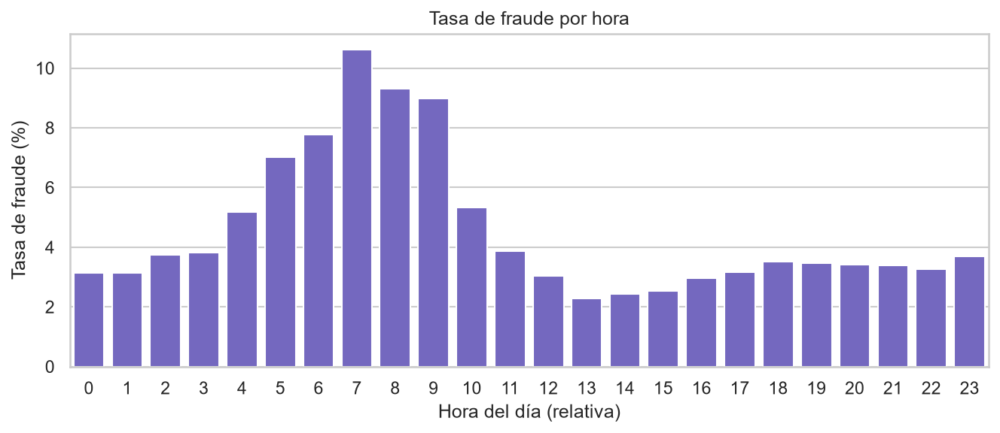
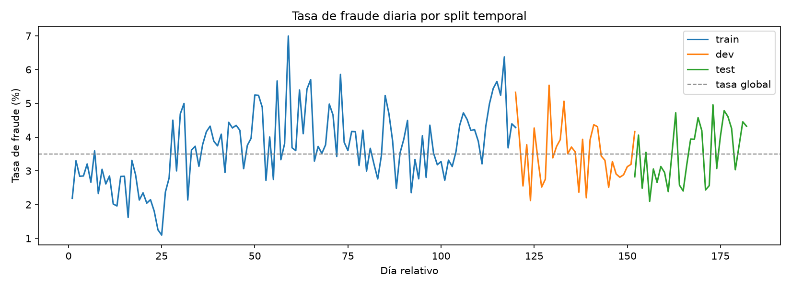
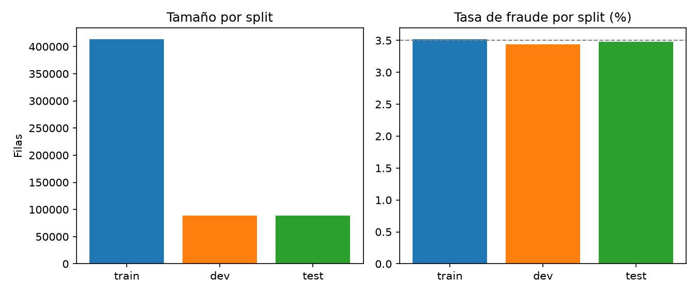
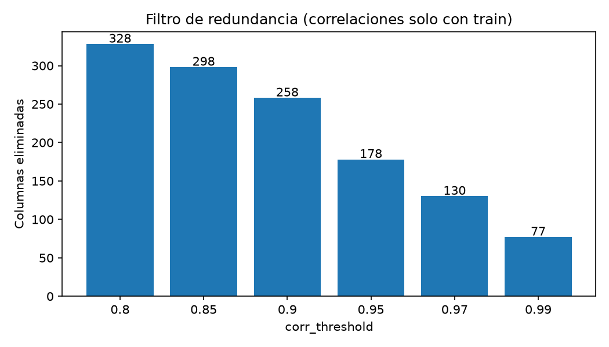

# Deep Learning-Based Financial Transaction Fraud Detection: A Comparative Study of Neural Network Architectures

> **Estado:** Etapa 1 (EDA) completa · Etapa 2 (preparación y protocolo) completa · Etapa 3 (modelado) en curso

## Problema

Una fracción muy pequeña de las transacciones es fraudulenta, pero cada una es costosa; al mismo tiempo, bloquear transacciones legítimas daña la experiencia del cliente.

## Objetivo

Desarrollar y evaluar redes neuronales profundas que clasifiquen transacciones financieras como legítimas o fraudulentas, comparando arquitecturas y estrategias de entrenamiento bajo desbalance de clases.

## Pregunta de investigación

¿En qué medida las arquitecturas MLP regularizadas y residuales mejoran la detección de fraude frente a una MLP convencional, considerando el desbalance de clases y el compromiso entre detectar fraude y generar falsas alertas?

## Hipótesis

Las arquitecturas con mayor capacidad de representación y mecanismos de regularización capturan mejor las relaciones no lineales entre las características transaccionales y mejoran la detección frente a una MLP básica.

## Dataset

- **Fuente:** competencia [IEEE-CIS Fraud Detection](https://www.kaggle.com/c/ieee-fraud-detection) (Kaggle). Los datos **no se redistribuyen**: se descargan desde Kaggle (ver `data/README.md`).
- **Archivos usados:** `train_transaction.csv` y `train_identity.csv`, unidos por `TransactionID` (el conjunto de test no tiene etiquetas).
- **Forma:** 590,540 transacciones × 434 columnas originales (más `has_identity`, derivada).
- **Objetivo:** `isFraud`, con 3.5% de fraude (20,663 casos), ratio 27.6 : 1.
- **Periodo:** ~182 días, con tiempo relativo en `TransactionDT` (segundos).
- **Variables:** anonimizadas, por familias (`C`, `D`, `M`, `V`, `id`, `card`, `addr`, correos, dispositivo). Solo el 24.4% de las transacciones tiene registro de identidad.

## Hallazgos clave del EDA

| Hallazgo | Implicación para el protocolo |
|---|---|
| Desbalance de 27.6 : 1 | PR-AUC como métrica principal (piso ≈ 0.035); pesos de clase o focal loss; sin sobremuestreo en dev/test |
| La tasa de fraude cambia con el tiempo (~2-3% al inicio, ~4-5% después) | Split temporal obligatorio; la deriva se documenta como limitación |
| El 24.4% tiene identidad y su fraude es 7.85% vs 2.09% sin ella | `has_identity` se conserva; los nulos de `id`/`device` son en gran parte estructurales |
| Solo hay 69 patrones distintos de nulos | Indicadores de nulo por patrón, no por columna (65 tras exigir al menos 50 filas por patrón en train) |
| La señal categórica está en variables de alta cardinalidad (`card1`, `DeviceInfo`, `id_31`, correos) | Embeddings (red) y codificación por frecuencia (baselines) |
| Las `V` son muy redundantes (1,443 pares con \|r\| > 0.9) y la señal individual es moderada (\|Spearman\| máx ≈ 0.40) | Filtro de redundancia y modelos no lineales |
| La hora relativa del día separa bien el fraude (pico ~10.6% en la hora 7, mínimo ~2.3%) | Hora derivada con codificación cíclica |
| El nulo no equivale a 0 (en `D7`, fraude 2.70% si falta vs 21.16% si vale 0) | Ningún nulo se imputa sin su indicador |
| Algunos precios recurrentes tienen tasas muy distintas de la base (57.95 → 0.38%, 150.00 → 6.71%) | Variables derivadas del importe exacto (`amt_cents`, `amt_freq`, `amt_price_point`) |

<p align="center">
  
  
</p>
<p align="center">
  
</p>

## Protocolo experimental y preparación de los datos

### Split temporal

Las transacciones se ordenan por `TransactionDT` y se cortan **por valor de tiempo** (no por posición de fila), de modo que un empate de tiempo nunca queda repartido entre dos conjuntos. Dev y test simulan el futuro: se entrena con el pasado y se evalúa con lo posterior.

| Split | Filas | Fraudes | Tasa de fraude | Piso de PR-AUC | Días relativos |
|---|---|---|---|---|---|
| train | 413,378 | 14,538 | 3.517% | 0.0352 | 1.0 - 120.8 |
| dev | 88,581 | 3,042 | 3.434% | 0.0343 | 120.8 - 152.2 |
| test | 88,581 | 3,083 | 3.480% | 0.0348 | 152.2 - 183.0 |

El piso de PR-AUC es el valor de un clasificador sin información (igual a la tasa de fraude): todo modelo debe superarlo con claridad.

<p align="center">
  
</p>

### Pipeline de preprocesamiento

Todo estadístico (medianas, medias, desviaciones, vocabularios, frecuencias, patrones de nulos, correlaciones) se calcula **solo con train** y se aplica a dev y test. El pipeline completo vive en la clase `Preprocessor` (`src/preprocessing.py`), se ajusta una vez y se guarda.

| Paso | Qué hace | Columnas |
|---|---|---|
| Datos de partida | Tabla unida con `has_identity` | 435 |
| Limpieza y derivadas | Se descartan `TransactionID`, `TransactionDT` crudo, el importe crudo y el objetivo; se derivan hora cíclica (`hour_sin`, `hour_cos`), `amt_log` y `amt_cents` | 435 |
| Indicadores de nulo | Uno por patrón de ausencia, antes de imputar | + 65 |
| Imputación | Mediana de train en numéricas; categoría `missing` en categóricas | sin NaN |
| Codificación | One-hot para baja cardinalidad; frecuencia e índice entero (para embeddings) para alta cardinalidad; importe exacto como `amt_freq` y `amt_price_point` | 98 (+ 13 índices) |
| Colas y escalado | `log1p` en 326 columnas muy asimétricas, estandarización con estadísticos de train, recorte de \|z\| a 10 | 411 numéricas |
| Filtro de redundancia | Se elimina una de cada par con \|r\| > 0.95 (se conserva la más asociada con el fraude) | 561 → **383** |

La matriz final tiene **383 columnas** (`X`) más **13 índices enteros** para las capas de embeddings (`idx`). El importe crudo se guarda aparte (`meta`) para el análisis de costo de la Etapa 4. No se remuestrea ningún conjunto: el desbalance se trata en el entrenamiento con pesos de clase (en train: 27.4 : 1, pesos 0.518 y 14.217) o focal loss.

<p align="center">
  
  
</p>

### Verificación anti-fuga

`tests/test_no_leakage.py` comprueba con datos sintéticos (13 pruebas, unos 4 segundos): orden temporal estricto entre splits, IDs disjuntos, empates de tiempo sin repartir, estadísticos iguales a los de train, dev escalado con la media y desviación de train, que `transform` no modifica nada de lo aprendido, categorías nuevas en el índice "desconocido", sin NaN ni infinitos y mismas columnas en los tres splits.

## Metodología

- **Split temporal 70 / 15 / 15** (train / dev / test), ordenado por `TransactionDT`. El test se usa **una sola vez**, al final.
- **Preprocesamiento ajustado solo con train** y aplicado a dev y test (medianas, escalado, vocabularios de categóricas, patrones de nulos).
- **Selección de modelo y umbral en dev**, nunca en test.
- **Costo asimétrico:** pesos de clase (y/o focal loss) durante el entrenamiento; el umbral se elige según costo esperado (`c_FN = 10`, `c_FP = 1`, supuestos ajustables en `configs/default.yaml`) y una precisión objetivo de 0.5.
- **Reproducibilidad:** semillas `[19, 69, 79]`; la búsqueda de hiperparámetros usa la primera y la configuración final se repite con las tres (media ± desviación).
- **Todo parámetro** (semillas, fracciones del split, umbrales, costos, hiperparámetros) sale de `configs/default.yaml`.

## Modelos

| Grupo | Modelo | Componentes |
|---|---|---|
| Baselines | Regresión logística, XGBoost | Número a superar |
| Redes | 1. MLP convencional | Dense + ReLU, inicialización He, entropía cruzada binaria, Adam |
| | 2. MLP regularizada | L2, Dropout, Batch Normalization, Early Stopping |
| | 3. MLP con embeddings | Embeddings para categóricas de alta cardinalidad |
| | 4. Residual MLP | Bloques densos, Batch Normalization, ReLU, conexiones residuales |
| Opcional | Autoencoder | Si alcanza el tiempo |

## Métricas

1. PR-AUC (principal)
2. ROC-AUC
3. Precision y recall
4. F1
5. Recall a precisión fija (precisión objetivo 0.5)
6. Matriz de confusión
7. Costo esperado
8. Calibración (Brier y curva de confiabilidad)

## Resultados

*Los baselines y las redes se completan en las Etapas 3 y 4 (primero en dev; la versión final, en test).*

| Modelo | Estrategia de costo | PR-AUC | ROC-AUC | Recall @ precisión fija | Costo esperado |
|---|---|---|---|---|---|
| Sin información (piso, en dev) | — | 0.0343 | 0.500 | — | — |
| Regresión logística | — | — | — | — | — |
| XGBoost | — | — | — | — | — |
| MLP convencional | — | — | — | — | — |
| MLP regularizada | — | — | — | — | — |
| MLP con embeddings | — | — | — | — | — |
| Residual MLP | — | — | — | — | — |

## Estructura del proyecto

```
fintech-fraud-detection/
├── README.md
├── requirements.txt         # pendiente (versiones fijas al terminar)
├── pytest.ini               # permite importar src desde las pruebas
├── .gitignore               # data/, models/, modelos pesados
├── configs/default.yaml     # semillas, fracciones del split, hiperparámetros, costos
├── data/
│   ├── README.md            # cómo descargar los datos
│   ├── raw/                 # ignorado
│   └── processed/           # Parquet (train/dev/test: X, idx, y, meta), ignorado
├── models/                  # preprocesador ajustado y pesos de las redes, ignorado
├── notebooks/
│   ├── 01_eda.ipynb
│   ├── 02_preprocessing_split.ipynb
│   ├── 03_baselines.ipynb
│   ├── 04_neural_networks.ipynb
│   └── 05_evaluation.ipynb
├── src/                     # data.py, split.py, preprocessing.py, models.py, train.py, evaluate.py
├── tests/test_no_leakage.py # max(t_train) < min(t_dev) < min(t_test), sin fugas
├── reports/                 # figures/, results.csv
└── docs/model_card.md
```

Estado de `src/`: `data.py`, `split.py` y `preprocessing.py` completos; `train.py` con los pesos de clase (el entrenamiento llega en la Etapa 3); `models.py` y `evaluate.py` pendientes.

## Cómo reproducir

1. Clonar el repositorio y crear el entorno (`requirements.txt` pendiente; hasta entonces: pandas, pyarrow, numpy, scipy, scikit-learn, matplotlib, seaborn, pyyaml, joblib, pytest, jupyter).
2. Descargar los datos de Kaggle y colocarlos en `data/raw/` (ver `data/README.md`).
3. Ejecutar los notebooks en orden: `01_eda.ipynb` y `02_preprocessing_split.ipynb` generan `data/processed/` y `models/preprocessor.joblib`; después `03` a `05`.
4. Verificar el protocolo: `python -m pytest tests/test_no_leakage.py -v`.
5. En cualquier notebook, cargar los datos ya procesados en una línea:

```python
from src.data import load_config
from src.preprocessing import load_split

cfg = load_config()
train = load_split(cfg, "train")   # {'X', 'idx', 'y', 'meta'}
```

## Limitaciones

- Variables anonimizadas: la interpretabilidad de las `V`, `C`, `D` y `M` es limitada.
- Deriva temporal: el comportamiento del fraude cambia (la tasa diaria oscila entre ~2% y ~5%), así que el desempeño en test puede diferir del de dev.
- Deriva de categorías: las versiones de navegador y sistema operativo cambian con el tiempo (en test, el 9.33% de las filas tiene un `id_31` que train no vio, frente a 0.19% en train).
- Valores faltantes que cambian con el tiempo: 43 columnas (`V95` a `V137`) no tienen nulos en train y sí en dev y test (0.27% y 0.08% de las filas); se imputan con la mediana de train sin indicador.
- `TransactionDT` es un tiempo relativo: la "hora" derivada no es la hora real del reloj. El dataset no trae un identificador de cliente explícito, por lo que no se modelan secuencias por usuario (descarta una arquitectura LSTM en este alcance).
- `has_identity` es un artefacto de recolección (el 24.4% de las transacciones tiene registro de identidad): puede no existir en otro entorno.
- Los precios recurrentes (`amt_freq`, `amt_price_point`) pueden cambiar con el tiempo, y el 19% de las filas tiene una tarjeta (`card1`) poco frecuente que cae en la categoría "desconocido".
- Solo comercio electrónico sin tarjeta presente.

