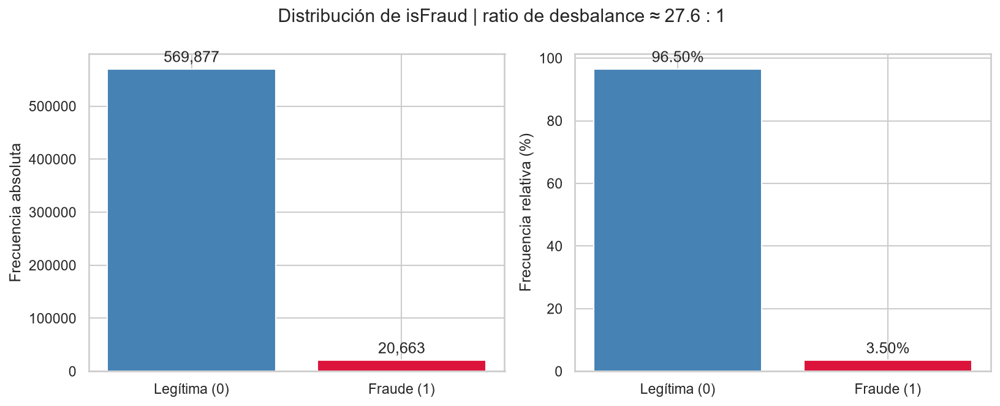
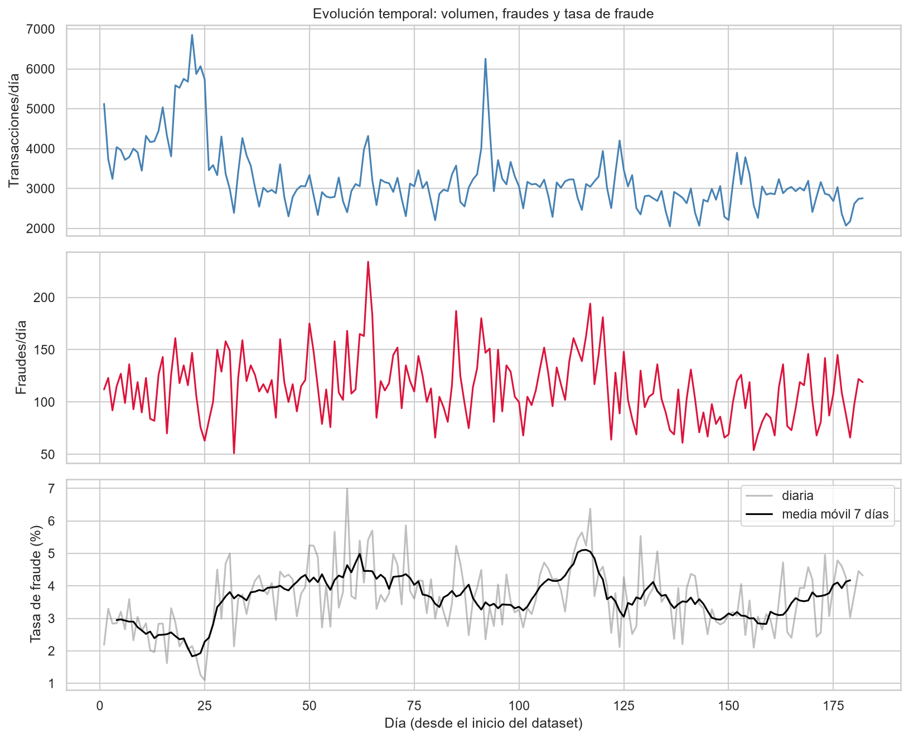

# Deep Learning-Based Financial Transaction Fraud Detection: A Comparative Study of Neural Network Architectures

> **Estado:** Etapa 1 (EDA) completa · Etapa 2 (preparación y protocolo) en curso

## Problema

Una fracción muy pequeña de las transacciones es fraudulenta, pero cada una es costosa; al mismo tiempo, bloquear transacciones legítimas daña la experiencia del cliente.

## Objetivo

Desarrollar y evaluar redes neuronales profundas que clasifiquen transacciones financieras como legítimas o fraudulentas, comparando arquitecturas y estrategias de entrenamiento bajo desbalance de clases.

## Pregunta de investigación

¿En qué medida las arquitecturas MLP regularizadas y residuales mejoran la detección de fraude frente a una MLP convencional, considerando el desbalance de clases y el compromiso entre detectar fraude y generar falsas alertas?

## Hipótesis

Las arquitecturas con mayor capacidad de representación y mecanismos de regularización capturan mejor las relaciones no lineales entre las características transaccionales y mejoran la detección frente a una MLP básica.

## Dataset

- **Fuente:** competencia [IEEE-CIS Fraud Detection](https://www.kaggle.com/c/ieee-fraud-detection) (Kaggle). Los datos **no se redistribuyen**: se descargan desde Kaggle (ver `data/README.md`).
- **Archivos usados:** `train_transaction.csv` y `train_identity.csv`, unidos por `TransactionID` (el conjunto de test no tiene etiquetas).
- **Forma:** 590,540 transacciones × 434 columnas originales (más `has_identity`, derivada).
- **Objetivo:** `isFraud`, con 3.5% de fraude (20,663 casos), ratio 27.6 : 1.
- **Periodo:** ~182 días, con tiempo relativo en `TransactionDT` (segundos).
- **Variables:** anonimizadas, por familias (`C`, `D`, `M`, `V`, `id`, `card`, `addr`, correos, dispositivo). Solo el 24.4% de las transacciones tiene registro de identidad.

## Hallazgos clave del EDA

| Hallazgo | Implicación para el protocolo |
|---|---|
| Desbalance de 27.6 : 1 | PR-AUC como métrica principal (piso ≈ 0.035); pesos de clase o focal loss; sin sobremuestreo en dev/test |
| La tasa de fraude cambia con el tiempo (~2-3% al inicio, ~4-5% después) | Split temporal obligatorio; la deriva se documenta como limitación |
| El 24.4% tiene identidad y su fraude es 7.85% vs 2.09% sin ella | `has_identity` se conserva; los nulos de `id`/`device` son en gran parte estructurales |
| Solo hay 69 patrones distintos de nulos | Indicadores de nulo por patrón, no por columna |
| La señal categórica está en variables de alta cardinalidad (`card1`, `DeviceInfo`, `id_31`, correos) | Embeddings (red) y codificación por frecuencia (baselines) |
| Las `V` son muy redundantes (1,443 pares con \|r\| > 0.9) y la señal individual es moderada (\|Spearman\| máx ≈ 0.40) | Filtro de redundancia y modelos no lineales |
| La hora relativa del día separa bien el fraude (pico ~10.6% en la hora 7, mínimo ~2.3%) | Hora derivada con codificación cíclica |

<p align="center">
  
  
</p>
<p align="center">
  
</p>

## Metodología

- **Split temporal 70 / 15 / 15** (train / dev / test), ordenado por `TransactionDT`. El test se usa **una sola vez**, al final.
- **Preprocesamiento ajustado solo con train** y aplicado a dev y test (medianas, escalado, vocabularios de categóricas, patrones de nulos).
- **Selección de modelo y umbral en dev**, nunca en test.
- **Costo asimétrico:** pesos de clase (y/o focal loss) durante el entrenamiento; el umbral se elige según costo esperado (`c_FN`, `c_FP`).
- **Reproducibilidad:** 3 semillas por configuración final (media ± desviación).

## Modelos

| Grupo | Modelo | Componentes |
|---|---|---|
| Baselines | Regresión logística, XGBoost | Número a superar |
| Redes | 1. MLP convencional | Dense + ReLU, inicialización He, entropía cruzada binaria, Adam |
| | 2. MLP regularizada | L2, Dropout, Batch Normalization, Early Stopping |
| | 3. MLP con embeddings | Embeddings para categóricas de alta cardinalidad |
| | 4. Residual MLP | Bloques densos, Batch Normalization, ReLU, conexiones residuales |
| Opcional | Autoencoder | Si alcanza el tiempo |

## Métricas

1. PR-AUC (principal) 
2. ROC-AUC, precision
3. Recall 
4. F1 recall a precisión fija
5. matriz de confusión 
6. costo esperado 
7. calibración (Brier).

## Resultados

*Se completa en la Etapa 4.*

| Modelo | Estrategia de costo | PR-AUC | ROC-AUC | Recall @ precisión fija | Costo esperado |
|---|---|---|---|---|---|
| Regresión logística | — | — | — | — | — |
| XGBoost | — | — | — | — | — |
| MLP convencional | — | — | — | — | — |
| MLP regularizada | — | — | — | — | — |
| MLP con embeddings | — | — | — | — | — |
| Residual MLP | — | — | — | — | — |

## Estructura del proyecto

```
fintech-fraud-detection/
├── README.md
├── requirements.txt         # pendiente (versiones fijas al terminar)
├── .gitignore               # data/, modelos pesados
├── configs/default.yaml     # semillas, fracciones del split, hiperparámetros, costos
├── data/
│   ├── README.md            # cómo descargar los datos
│   ├── raw/                 # ignorado
│   └── processed/           # Parquet, ignorado
├── notebooks/
│   ├── 01_eda.ipynb
│   ├── 02_preprocessing_split.ipynb
│   ├── 03_baselines.ipynb
│   ├── 04_neural_networks.ipynb
│   └── 05_evaluation.ipynb
├── src/                     # data.py, split.py, preprocessing.py, models.py, train.py, evaluate.py
├── tests/test_no_leakage.py # max(t_train) < min(t_dev) < min(t_test), sin fugas
├── reports/                 # figures/, results.csv
└── docs/model_card.md
```

## Cómo reproducir

1. Clonar el repositorio y crear el entorno (`requirements.txt` pendiente).
2. Descargar los datos de Kaggle y colocarlos en `data/raw/` (ver `data/README.md`).
3. Ejecutar los notebooks en orden (`01` a `05`).

## Limitaciones

- Variables anonimizadas: la interpretabilidad de las `V`, `C`, `D` y `M` es limitada.
- Deriva temporal: el comportamiento del fraude cambia, así que el desempeño en test puede diferir del de dev.
- `TransactionDT` es un tiempo relativo y el dataset no trae un identificador de cliente explícito, por lo que no se modelan secuencias por usuario (descarta una arquitectura LSTM en este alcance).


